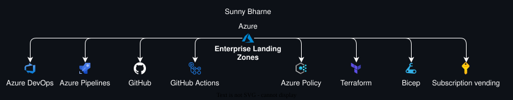

# Sunny Bharne, I do all things Azure.

###### A developer with a decade of experience | Helsinki, Finland.

---

### What I work on

- Azure DevOps pipelines, self-hosted agents, repos, and service connections.
- I use GitHub Actions to build and deploy [my website](https://www.sunnybharne.com/) to GitHub Pages.
- Subscriptions, management groups, and landing zones in Terraform and Bicep for [Papliba](https://papliba.com/). The platform lives in the [Papliba GitHub organization](https://github.com/papliba).
- Azure Policy releases, ServiceNow change management, and infrastructure tests with Pester and Terraform.

Before Azure, I built Java and Selenium frameworks for regression and integration tests.

---

###### I use [VIM](https://github.com/sunnybharne/nvim), Judge me!

---

### Latest from my YouTube — [@sunnybharne](https://www.youtube.com/@sunnybharne)

<!-- YOUTUBE:START -->
<table>
  <tr>
    <td align="center" width="33%"> <a href="https://www.youtube.com/watch?v=xqmfjCbvqgc"><b>Normal Coding Day 2 | Building a Workflow Orchestrator</b></a> 1.8K · 2d ago</td>
    <td align="center" width="33%"> <a href="https://www.youtube.com/watch?v=_FB_mPdOwjM"><b>Pi Used 51% Fewer Tokens Than Codex — But There’s a Catch</b></a> 357 · 3mo ago</td>
    <td align="center" width="33%"> <a href="https://www.youtube.com/watch?v=rPmby-3YCCc"><b>Why AI Made Me Give Up Vim and Return to VS Code</b></a> 1.4K · 3mo ago</td>
  </tr>
  <tr>
    <td align="center" width="33%"> <a href="https://www.youtube.com/watch?v=awCupq9jkQ4"><b>Normal Coding Day | Building a New Email Client</b></a> 6.5K · 4mo ago</td>
    <td align="center" width="33%"> <a href="https://www.youtube.com/watch?v=aHygd83XVdU"><b>2026 Desk Setup Upgrade | Cockpit Mode</b></a> 299 · 5mo ago</td>
    <td align="center" width="33%"> <a href="https://www.youtube.com/watch?v=d3y5ABV5_34"><b>Claude vs Qwen 7B: Can a Local LLM Replace Claude?</b></a> 2.1K · 6mo ago</td>
  </tr>
</table>

↑ latest from <a href="https://www.youtube.com/@sunnybharne">@sunnybharne</a>
<!-- YOUTUBE:END -->

---
